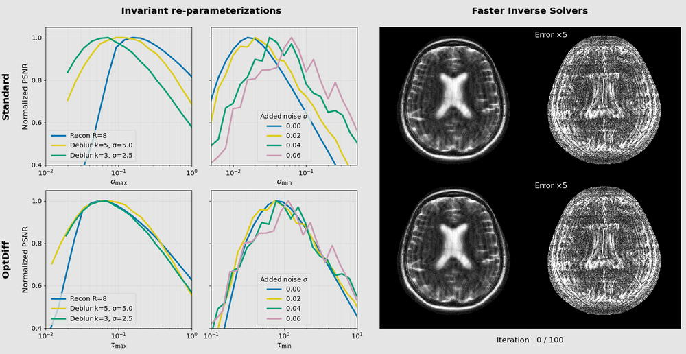
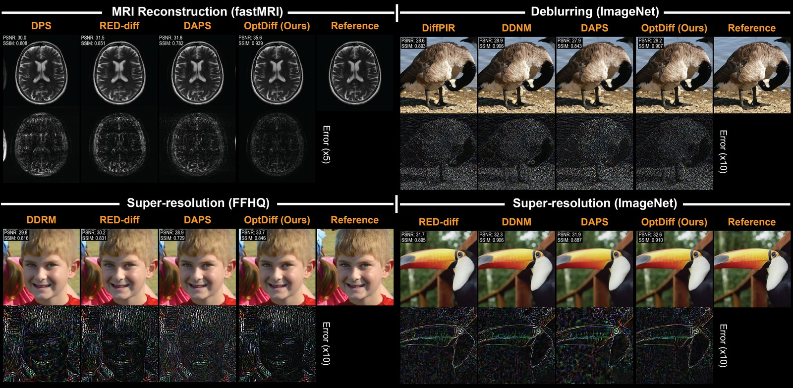

# Principled Design of Diffusion-based Optimizers for Inverse Problems (NeurIPS 2026)

### [Paper](https://arxiv.org/abs/2605.11506) | [Project page](https://mrsrl.github.io/OptDiff/) | [BibTeX](#citation)




## Overview

Diffusion-based inverse solvers often need hundreds of steps, and their inference-time hyperparameters usually have
to be retuned for every problem. Building on RED-diff, which treats posterior sampling as an optimization problem,
**OptDiff** (Optimizers with Diffusion-based priors) reparameterizes these hyperparameters so that their values carry
over across problems:

- **Noise schedule:** the start and stop noise levels follow from relative tolerances, so the schedule adapts to the
  measurements and the noise floor.
- **Sampler:** normalized gradients balance data consistency and the diffusion prior with a single trade-off value
  for the whole reverse process.
- **Tuning and acceleration:** a greedy-optimal scheme tunes the two families separately, and momentum and
  preconditioning reduce the number of network evaluations.

The repository contains OptDiff and the baselines of the paper for two domains:

- **Natural images:** ImageNet and FFHQ 256x256 super-resolution, deblurring and inpainting with guided-diffusion
  priors. Baselines: DDNM, DiffPIR, DPS, DDRM, RED-diff.
- **MRI:** fastMRI brain T2 reconstruction with an EDM prior. Baselines: RED-diff, DPS, ΠGDM, DAPS, DiffPIR.



## Setup

### 1. Environment

The environment is managed with [uv](https://docs.astral.sh/uv/) (Linux, NVIDIA GPU):

```bash
uv sync                    # Python 3.9 and PyTorch 1.12.1 (CUDA 11.6) in .venv/
source .venv/bin/activate
```

### 2. Pretrained models

You can use the provided script to download the model checkpoints used in this work:
```bash
bash download.sh                  # all models into checkpoints/ (4.3 GB download)
bash download.sh imagenet ffhq    # or some of them: imagenet, ffhq, fastmri
```

| Dataset | Model | Source |
| --- | --- | --- |
| ImageNet | 256x256 unconditional model | [guided-diffusion](https://github.com/openai/guided-diffusion) |
| FFHQ | 256x256 model | [P2 weighting](https://github.com/jychoi118/P2-weighting) |
| fastMRI | EDM prior trained on fully sampled brain data | [ambient-diffusion-mri](https://github.com/utcsilab/ambient-diffusion-mri) |

### 3. Test data

We provide data preparation scripts to generate the test sets used in this work. `data/lists/` lists the files of
each test set. First, download [ImageNet](https://image-net.org/), [FFHQ](https://github.com/NVlabs/ffhq-dataset) and
[fastMRI](https://fastmri.med.nyu.edu/) from their sources, then prepare the test sets with the provided scripts:

```bash
# ImageNet
python scripts/prepare_natimg.py imagenet /path/to/ILSVRC2012
# FFHQ
python scripts/prepare_natimg.py ffhq /path/to/ffhq-dataset/images1024x1024
# fastMRI
TOOLBOX_PATH=/path/to/bart python scripts/prepare_fastmri.py /path/to/multicoil_test_full
```

The fastMRI data preparation requires [BART](https://mrirecon.github.io/bart/) for coil sensitivity estimation.
The `TOOLBOX_PATH` environment variable must point to the BART folder, with the `bart` binary and its Python wrapper in
`python/`.

The inpainting mask, the MRI sampling masks and the coefficients of OptDiff's preconditioner are included in `data/`.

**Sample images.** To try the code without preparing a test set, five FFHQ test images are included in
`data/samples/ffhq/`. You can directly specify this directory for inference (see [Quick start](#quick-start)).

## Quick start

`main_natimg.py` and `main_mri.py` run one method (algo) on a set of test images. Every setting is a
[Hydra](https://hydra.cc/) override on the command line. Run them from the repository root: the paths in the configs
(data, checkpoints, masks) are relative to it.

The default config, `configs/natimg/default.yaml`, runs OptDiff on all 330 FFHQ test images for Gaussian deblurring
(`deblur_gauss_window6_sigma3`) with 100 steps, using the paper's noise schedule and sampler hyperparameters, and
writes its outputs to `outputs/default/`. Single values can be changed on the command line:

```bash
# Default config: OptDiff, FFHQ, Gaussian deblurring, 100 steps
python main_natimg.py --config-name default
# Use the sample images in data/samples/ffhq
python main_natimg.py --config-name default data_config.input_dir=data/samples/ffhq
# The first 10 test images, on GPU 1
python main_natimg.py --config-name default data_config.slice=10 model_config.device=1
```

## Reproducing the paper

The tuned values of the paper's main comparisons are in `configs/<domain>/tuned/`. We additionally provide driver
scripts that run the paper's main table cells (dataset, task, NFE combination) with these values and write the metrics
to `outputs/optdiff_comparisons/<domain>/summary.md`:

```bash
python scripts/run_optdiff_comparisons_natimg.py --devices 0 1 2
python scripts/run_optdiff_comparisons_mri.py --devices 0 1 2

# A subset of the cells; --dry-run prints the commands
python scripts/run_optdiff_comparisons_natimg.py --datasets ffhq --tasks sr16 --steps 20 --methods optdiff
```

## Config details

A run starts from a dataset config: `configs/natimg/imagenet.yaml`, `configs/natimg/ffhq.yaml` or
`configs/mri/fastmri.yaml`. These hold the data, model and output settings. The values marked `???` (the task, the
method's settings and the noise schedule) are given on the command line: as single values or, for OptDiff's noise
schedule and weights, also as files selected by name (see
[Noise schedule and weights](#noise-schedule-and-weights-files-or-values)). `configs/natimg/default.yaml` is a complete
natural-image run with all of them filled in.

```bash
# OptDiff on ImageNet, 4x super-resolution, 20 steps: noise schedule and weights from files selected by name
python main_natimg.py --config-name imagenet \
    data_config.deg=sr4 data_config.input_noise=0.02 \
    algo=optdiff noise_schedule_config.num_steps=20 noise_schedule_config=example_schedule \
    optimizer_config.weights=heuristics optimizer_weights_config=example_weights optimizer_config.preconditioner=true

# The same run with the values on the command line instead of the files
python main_natimg.py --config-name imagenet \
    data_config.deg=sr4 data_config.input_noise=0.02 \
    algo=optdiff noise_schedule_config.num_steps=20 \
    noise_schedule_config.sigma_max=5 noise_schedule_config.sigma_min=0.08 noise_schedule_config.rho=-7 \
    optimizer_config.weights=heuristics optimizer_config.preconditioner=true \
    'optimizer_weights_config={alpha:{function:linear,parameters:[-0.256516,5.7207276]},lamda:{function:constant,parameters:2.5061100871006348},beta:{function:linear,parameters:[-0.04275091,0.89096716]}}'

# A baseline: DPS on FFHQ, 4x super-resolution, 100 steps, on its default noise schedule
python main_natimg.py --config-name ffhq \
    data_config.deg=sr4 data_config.input_noise=0.01 \
    algo=dps noise_schedule_config.num_steps=100 baseline_config.eta=0.8 baseline_config.grad_term_weight=8.0

# MRI: OptDiff on test volume 0, R=8, 100 steps
python main_mri.py --config-name fastmri \
    data_config.file=0 data_config.accel=8 data_config.mask_path=data/masks/random1d_8_384.npy \
    algo=optdiff noise_schedule_config.num_steps=100 noise_schedule_config=example_schedule \
    optimizer_config.weights=heuristics optimizer_weights_config=example_weights optimizer_config.preconditioner=true
```

Each part of a run is set as follows:

| Part | Natural images | MRI |
| --- | --- | --- |
| Dataset (`--config-name`) | `imagenet` or `ffhq` | `fastmri` |
| Test data (`data_config`) | `slice` (`all`, the default; the first N images; or a list of indices); `deg`: `sr4`, `sr16`, `deblur_gauss_window6_sigma3`, `deblur_gauss_window12_sigma3` or `inpainting_mask`; `input_noise` (images in [-1, 1]) | `file` (volume index, in sorted order); `accel` (4 or 8) with its `mask_path`, `data/masks/random1d_<R>_384.npy` |
| Method (`algo`) | `optdiff`, or a baseline: `ddnm`, `diffpir`, `dps`, `ddrm`, `reddiff` | `optdiff`, or a baseline: `reddiff`, `dps`, `pigdm`, `daps`, `diffpir` |
| Noise schedule (`noise_schedule_config`) | `num_steps`, and a file: `edm` (OptDiff's default) with `sigma_max`, `sigma_min`, `rho`, or `example_schedule`; `standard` (evenly spaced timesteps, the baselines' default) | `num_steps`, with `sigma_max`, `sigma_min`, `rho` or a file: `example_schedule`, or `standard` (EDM's standard schedule) |
| Method settings | OptDiff (`optimizer_config`): `weights` (`heuristics` with a weights file, or `optimal`, an oracle from the reference used for tuning), and the switches `momentum`, `preconditioner`, `initial_estimate` (`cg_recon`, `adjoint`, `zero` or `random`) and `normalize_obs`. A baseline: the values marked `???` in `configs/natimg/algo/<method>.yaml` | OptDiff: as for natural images, without `normalize_obs`; `weights` can also be `optimal_cnst_lamda`. A baseline: the values marked `???` in `configs/mri/algo/<method>.yaml` |

The paper's values for every task, number of steps and method are in `configs/<domain>/tuned/`
(see [Reproducing the paper](#reproducing-the-paper)).

### Noise schedule and weights: files or values

OptDiff's noise schedule and heuristic weights can be set in two ways, as in the first two examples above:

- **Files selected by name.** `noise_schedule_config=<name>` loads `configs/<domain>/noise_schedule_config/<name>.yaml`,
  and `optimizer_weights_config=<name>` loads `configs/<domain>/optimizer_weights_config/<name>.yaml`. The folders hold
  one of the paper's settings as `example_schedule.yaml` and `example_weights.yaml`. For your own setting, copy them,
  change the values and select the copies by name. Single values on the command line still override a file, e.g.
  `noise_schedule_config.rho=-5`.
- **Values on the command line.** The schedule as `noise_schedule_config.sigma_max`, `sigma_min` and `rho`, and the
  weights as one value, `'optimizer_weights_config={alpha:{...},lamda:{...},beta:{...}}'`.

A natural-image schedule file sets `type: edm` with `sigma_max`, `sigma_min` and `rho`, or `type: uniform` with
`start_step` and `end_step`; an MRI schedule file sets `sigma_max`, `sigma_min` and `rho`. The weights are `alpha`,
`lamda` and `beta` (used with momentum), each given by its functional form (`linear`, `linear_2`, `exp` or
`constant`) and its `parameters`. The MRI weights also set their `parameterization`. The weights are fitted for one
noise schedule and number of steps, so a new schedule usually needs new weights.

### Outputs

A run writes the reconstructions and `metrics.txt` to `outputs/` (`output_config.output_dir`);
`python utils/print_metrics.py outputs/metrics.txt` prints the means.

## Acknowledgements

This code builds on [EDM](https://github.com/NVlabs/edm) (`dnnlib/`, `torch_utils/`),
[RED-diff](https://github.com/NVlabs/RED-diff), [guided-diffusion](https://github.com/openai/guided-diffusion),
[fastMRI](https://github.com/facebookresearch/fastMRI) and [InverseBench](https://github.com/devzhk/InverseBench), and
on the code released with [DPS](https://github.com/DPS2022/diffusion-posterior-sampling),
[DDRM](https://github.com/bahjat-kawar/ddrm), [DDNM](https://github.com/wyhuai/DDNM),
[DiffPIR](https://github.com/yuanzhi-zhu/DiffPIR) and [DAPS](https://github.com/zhangbingliang2019/DAPS).

## Citation

```bibtex
@inproceedings{oscanoa2026optdiff,
  title         = {Principled Design of Diffusion-based Optimizers for Inverse Problems},
  author        = {Oscanoa, Julio and Sivgin, Irmak and Alkan, Cagan and Ennis, Daniel and Pauly, John and
                   Pilanci, Mert and Vasanawala, Shreyas},
  booktitle     = {Advances in Neural Information Processing Systems},
  year          = {2026},
  eprint        = {2605.11506},
  archivePrefix = {arXiv},
  primaryClass  = {cs.CV},
  url           = {https://arxiv.org/abs/2605.11506}
}
```
